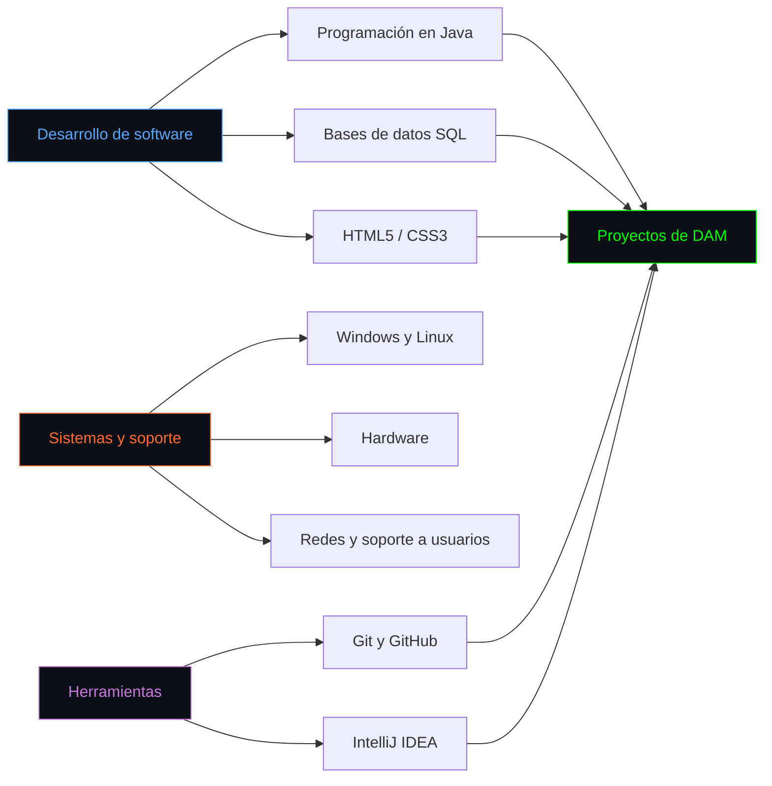

<p align="center">

</p>
<p align="center">
  
</p>

<p align="center">
  <a href="https://github.com/fcuurbeelo?tab=followers">
    
  </a>
  &nbsp;&nbsp;
  <a href="https://github.com/fcuurbeelo?tab=repositories">
    
  </a>
</p>

<div align="center">

<a href="https://github.com/fcuurbeelo">
  
</a>

</div>

<!-- ━━━━━━━━━━━━━━━━━━━━━━━━━━━━━━━━━━━━━━━━━━━━━━━━━━━━━━━━ -->


<p align="center">
 
</p>

<!-- ━━━━━━━━━━━━━━━━━━━━━━━━━━━━━━━━━━━━━━━━━━━━━━━━━━━━━━━━ -->

##  Sobre mí

<p align="center">
  <picture>
    <source media="(prefers-color-scheme: light)" srcset="https://www.gitskins.com/api/section/about?username=fcuurbeelo&theme=github-dark&mode=light" />
    
  </picture>
</p>

<div align="left">

```java
public class Francisco {

    String nombre = "Francisco Curbelo Robaina";
    String rol = "Estudiante de DAM";
    String estudios = "DAM · IES Lomo de la Herradura";
    String formacionAnterior = "Sistemas Microinformáticos y Redes";

    String[] lenguajes = {
        "Java",
        "Python",
        "JavaScript (básico)"
    };

    String[] basesDeDatos = {
        "SQL",
        "MySQL",
        "PostgreSQL",
        "MongoDB"
    };

    String[] desarrolloWeb = {
        "HTML5",
        "CSS3"
    };

    String[] herramientas = {
        "Git",
        "GitHub",
        "Linux",
        "IntelliJ IDEA"
    };

    String[] competencias = {
        "Programación en Java",
        "Bases de datos relacionales",
        "Soporte técnico a usuarios",
        "Hardware y sistemas operativos",
        "Redes"
    };
}
```

Soy estudiante de DAM. Antes hice SMR y trabajé como técnico SAT.
Me gusta probar lo que voy aprendiendo con proyectos, sobre todo en Java.
No lo sé todo: busco una oportunidad junior para seguir aprendiendo en un equipo.

También he participado en una aplicación interna con PHP y Laravel.

</div>

<p align="center">
  
</p>

<!-- ━━━━━━━━━━━━━━━━━━━━━━━━━━━━━━━━━━━━━━━━━━━━━━━━━━━━━━━━ -->

##  Stack tecnológico

<p align="center">
  <picture>
    <source media="(prefers-color-scheme: light)" srcset="https://www.gitskins.com/api/section/stack?username=fcuurbeelo&theme=github-dark&mode=light" />
    
  </picture>
</p>

<div align="center">

#### Lenguajes

<p>
  
</p>


#### Bases de datos
<p>
  
</p>


### Desarrollo web

<p>
  
</p>


#### Herramientas

<p>
  
</p>


<p align="center">
  
</p>

<!-- ━━━━━━━━━━━━━━━━━━━━━━━━━━━━━━━━━━━━━━━━━━━━━━━━━━━━━━━━ -->

## Mapa de competencias



<p align="center">
  
</p>


<!-- ━━━━━━━━━━━━━━━━━━━━━━━━━━━━━━━━━━━━━━━━━━━━━━━━━━━━━━━━ -->

## Abierto a colaboración

<table width="100%">
  <tr>
    <td align="center" width="25%">
      
      <br><br>
      <strong>Backend</strong>
      <br><br>
      Java · Python<br>
      Proyectos de DAM<br>
      Programación
    </td>
    <td align="center" width="25%">
      
      <br><br>
      <strong>Bases de datos</strong>
      <br><br>
      MySQL · PostgreSQL<br>
      MongoDB · SQL<br>
      Gestión de datos
    </td>
    <td align="center" width="25%">
      
      <br><br>
      <strong>Desarrollo web</strong>
      <br><br>
      HTML5 · CSS3<br>
      Maquetación<br>
      Proyectos de clase
    </td>
    <td align="center" width="25%">
      
      <br><br>
      <strong>Herramientas</strong>
      <br><br>
      Git · GitHub<br>
      Linux · IntelliJ IDEA<br>
      Control de versiones
    </td>
  </tr>
</table>

Busco **oportunidades junior y proyectos de desarrollo de software** para poner en práctica lo que estudio y seguir aprendiendo.

Ahora estoy centrado en Java y bases de datos. Puedes ver mi [gestor de alumnos en Java](https://github.com/fcuurbeelo/Gestor_Alumnos_Java), un proyecto de consola de DAM.

<p align="center">
  
</p>

---

<!-- ━━━━━━━━━━━━━━━━━━━━━━━━━━━━━━━━━━━━━━━━━━━━━━━━━━━━━━━━ -->

## Estadísticas de GitHub

<p align="center">
  <picture>
    <source media="(prefers-color-scheme: light)" srcset="https://www.gitskins.com/api/section/stats?username=fcuurbeelo&theme=github-dark&mode=light" />
    
  </picture>
</p>

<div align="center">


<br>

<picture>
  <source media="(prefers-color-scheme: dark)" srcset="https://github-readme-streak-stats.herokuapp.com/?user=fcuurbeelo&theme=tokyonight&hide_border=true&background=0D1117&stroke=00D9FF&ring=00D9FF&fire=FF6B35&currStreakLabel=00D9FF&cache_bust=5"/>
  
</picture>&nbsp;&nbsp;<picture>
  <source media="(prefers-color-scheme: dark)" srcset="https://github-readme-stats.vercel.app/api/top-langs/?username=fcuurbeelo&layout=compact&theme=tokyonight&hide_border=true&bg_color=0D1117&title_color=00D9FF&text_color=FFFFFF&langs_count=10&cache_bust=5"/>
  
</picture>

</div>

<p align="center">
  
</p>

<!-- ━━━━━━━━━━━━━━━━━━━━━━━━━━━━━━━━━━━━━━━━━━━━━━━━━━━━━━━━ -->
## Terreno 3D de contribuciones

<div align="center">

El terreno 3D todavía no está configurado en mi cuenta.
<!-- Activar el workflow de contribuciones 3D antes de añadir su imagen. -->

</div>

<p align="center">
  
</p>

<!-- ━━━━━━━━━━━━━━━━━━━━━━━━━━━━━━━━━━━━━━━━━━━━━━━━━━━━━━━━ -->

## Conecta conmigo

<p align="center">
  <a href="mailto:f.cuurbeelo@gmail.com"></a>&nbsp;
  <a href="https://www.linkedin.com/in/francisco-curbelo-robaina-89378a253/"></a>&nbsp;
  <a href="https://github.com/fcuurbeelo"></a>&nbsp;
</p>

---

<div align="center">

> Gracias por pasarte por mi perfil.

<br>


</div>
